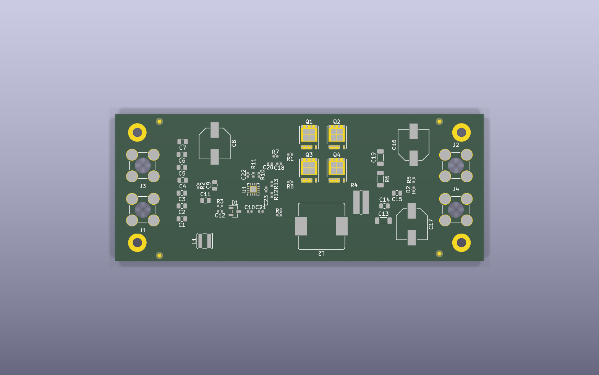

# Desafio de Hardware TRACTIAN · Tech Fast Track 2026

Projeto que desenvolvi no desafio técnico de hardware do processo **Tech Fast Track 2026** da TRACTIAN.

## Escopo

O desafio teve duas etapas.

### Task 1: pré-projeto de um sistema de aquisição multicanal de sinais

Documento: [`task1-pre-projeto/`](task1-pre-projeto/)

- Arquitetura do sistema e diagrama de blocos funcionais
- Escolha de circuitos integrados comerciais para cada bloco, com justificativa
- Interfaces de comunicação
- Robustez para ambiente industrial: isolação, proteção e alimentação

### Task 2: placement de componentes de um conversor DC/DC buck 24 V para 5 V (20 A)

Projeto KiCad: [`task2-pcb-placement/`](task2-pcb-placement/)

- Loops de alta corrente minimizados
- Estágio de potência separado do controle
- Integridade dos sinais sensíveis: feedback, compensação e sense de corrente
- Menos EMI e menos efeitos parasitas

## Principais decisões de projeto

- MOSFETs agrupados de forma compacta para reduzir o loop de comutação
- Indutor perto do nó SW
- Capacitores de entrada e de saída agrupados para responder bem a transientes
- Rede de feedback e compensação perto do controlador
- Gate drive com trilhas curtas (R1 e R8)
- Bootstrap e redes auxiliares perto do U1

O layout equilibra a área disponível na placa, a proximidade elétrica, a separação funcional e a legibilidade.

## Ferramentas

- KiCad 9

## Observação

O enunciado do desafio pertence à TRACTIAN e não está neste repositório. O esquemático do conversor veio do projeto inicial fornecido no desafio; o posicionamento dos componentes na placa e o pré-projeto da Task 1 são trabalho meu.
